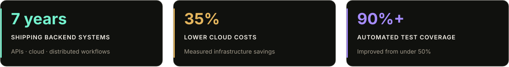
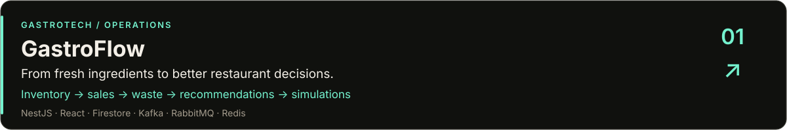
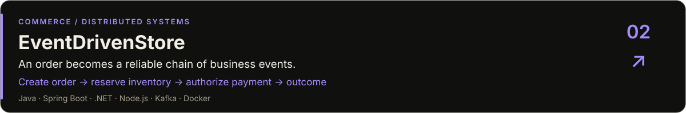
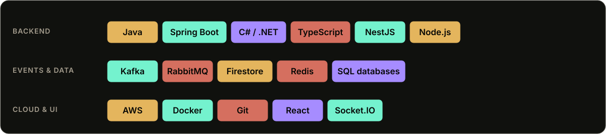

&nbsp;
&nbsp;

## 👋 The engineer behind the systems

I’m **Alejandro**, a Senior Backend Engineer with **7 years of experience** building APIs and distributed systems in **Java, C#, and TypeScript**. I care about what happens after the happy path: duplicate events, partial failures, slow queries, and the next release.

My work spans **Spring Boot, .NET, and Node.js/NestJS**, with cloud experience across **AWS and Firestore on GCP**. I focus on secure APIs, event-driven integration, database performance, and automated testing.

📍 **San Francisco, CA** · 💼 **Experience at Electronic Tax Systems, Inc.** · 🤝 **Open to opportunities and collaboration**

## 🚀 Systems I’m building

A restaurant operations platform that connects inventory, recipes, sales, waste tracking, recommendations, and decision simulations. It explores **auditable domain events**, asynchronous processing, and live dashboards that help teams make their next operational decision.

[Explore GastroFlow →](https://github.com/programmeralek/GastroFlow)

A distributed order-processing system with independent services for orders, inventory, and billing. It explores **saga choreography, transactional outbox patterns, idempotent consumers, and service-owned databases** to handle multi-step transactions and partial failures.

[Explore EventDrivenStore →](https://github.com/programmeralek/EventDrivenStore)

## 🛠️ Tools with a purpose

- **Backend:** clear service boundaries, secure REST APIs, and explicit contracts.
- **Distributed systems:** domain events, saga choreography, transactional outbox, and idempotent consumers.
- **Data:** Firestore, MySQL, MSSQL, MariaDB, and Redis.
- **Delivery:** AWS, Docker, containerized development, and automated tests.
- **Product surfaces:** React, TypeScript, and live updates with Socket.IO.

## 🌱 Beyond the backend

I’m exploring **gastrotech**: the space where food, software, and human context meet. GastroFlow is one practical expression of that curiosity; my [portfolio](https://programmeralek.com) shares the broader direction behind **Munch**.

## 🤝 Let’s build something useful

I’m open to backend engineering opportunities and collaboration on **APIs, distributed systems, and practical tools**.

&nbsp;
&nbsp;

**Reliable systems. Clear contracts. Measurable outcomes.**

